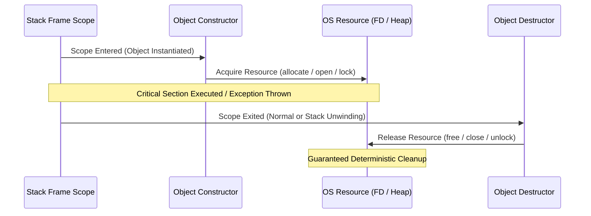

# Modern C++ Systems Architecture Masterclass (C++11 to C++23)

[](https://isocpp.org/)
[](https://en.cppreference.com/w/cpp/compiler_support)
[](https://cmake.org/)
[](https://github.com/google/sanitizers)
[](#architectural-foundations)
[](LICENSE)

> A production-grade, architectural deep dive into Modern C++ (C++11, C++14, C++17, C++20, and C++23). Designed for systems engineers, low-latency infrastructure architects, and high-performance computing developers transitioning from legacy C or C++98/03 into zero-cost, type-safe, concurrent modern systems.

---

## Executive Summary & Design Philosophy

Modern C++ has undergone a total paradigm transformation since the ratification of C++11. What was once historically characterized as "C with Classes" and manual pointer management has evolved into a strongly typed, zero-overhead systems language built upon three foundational tenets:

1. **Deterministic Resource Management (RAII)**: Zero reliance on non-deterministic garbage collection runtimes. Resource allocation is tied strictly to object lifetime, guaranteeing deterministic release of memory, file descriptors, network sockets, and mutex locks at the closing brace of its enclosing scope.
2. **Zero-Cost Abstractions**: The principle that you do not pay for what you do not use, and abstractions compile down to code as optimal as hand-written assembly. Polymorphism is shifted from runtime vtables to compile-time parametric polymorphism via Templates, Concepts, and `constexpr` evaluation whenever possible.
3. **Value Semantics and Move Semantics**: Eliminating deep defensive copying by decoupling an object's identity from its underlying heap payload. Move semantics transform costly $O(N)$ heap buffer cloning operations into single $O(1)$ pointer swaps at near-zero execution cost.

```
+---------------------------------------------------------------------------------------------------+
|                                  MODERN C++ SYSTEM ARCHITECTURE                                   |
+---------------------------------------------------------------------------------------------------+
|  Compile-Time Metaprogramming            Type System & Constraints        Runtime Zero-Overhead    |
|  - constexpr / consteval                 - Concepts & Constraints         - Value Categories       |
|  - Type Traits & SFINAE                  - Type Deduction (auto, decltype)- Move Semantics & RAII  |
|  - Fold Expressions & Variadics          - std::span, std::string_view    - Memory Model & Atomics |
+---------------------------------------------------------------------------------------------------+
                                                  |
                                                  v
+---------------------------------------------------------------------------------------------------+
|                                   COMPILER PIPELINE & CODEGEN                                     |
+---------------------------------------------------------------------------------------------------+
|  Source (.cpp/.ixx) ---> Clang / GCC / MSVC Frontend ---> AST & Concept Validation                |
|  ---> Template Instantiation & SFINAE Elision ---> LLVM IR / GIMPLE Intermediate Representation   |
|  ---> Optimizers (Inlining, RVO, Loop Vectorization) ---> Machine Code (.obj)                     |
+---------------------------------------------------------------------------------------------------+
                                                  |
                                                  v
+---------------------------------------------------------------------------------------------------+
|                                   EXECUTION ENGINE & HARDWARE                                     |
+---------------------------------------------------------------------------------------------------+
|  Registers <-> L1/L2/L3 Cache Hierarchy <-> RAM Bus (Non-Uniform Memory Access - NUMA)             |
|  Hardware Atomics, Sequential Consistency, Relaxed Barriers, CPU Branch Predictor Unit            |
+---------------------------------------------------------------------------------------------------+
```

---

## Architectural Comparison Matrix

| Dimension | Legacy C++ (C++98 / C++03) | Modern C++ (C++11 / C++14 / C++17) | Modern C++ (C++20 / C++23) | Rust | C |
| :--- | :--- | :--- | :--- | :--- | :--- |
| **Memory Safety Paradigm** | Raw pointers, manual `delete` | Smart Pointers (`unique_ptr`, `shared_ptr`), RAII | RAII + `std::span` bounds check + Sanitizers | Compile-time borrow checker | Manual `free()`, unmanaged |
| **Move Semantics** | Non-existent; copy constructor or raw pointer hack | Move semantics (`&&`, `std::move`, `std::forward`) | Move semantics + NRVO standardization | Move-by-default bitwise memcpy | Manual pointer reassignments |
| **Generics / Templates** | Untyped template bloat, cryptic error cascades | SFINAE (`std::enable_if`), variadic templates | C++20 `Concepts` (`requires`), Constrained templates | Trait bounds (`where T: Trait`) | Void pointers (`void*`), Macros |
| **Compile-Time Execution** | Enum hacks, template recursion | `constexpr`, `constexpr if` | `consteval`, `constinit`, compile-time allocation | `const fn` | Preprocessor macros |
| **Asynchronous Engine** | Raw pthreads, `fork`, callbacks | `std::thread`, `std::async`, `std::future` | Native Coroutines (`co_await`, `co_yield`) | `async`/`await` state machines | Callbacks, OS event loops (epoll/kqueue) |
| **Data Pipelines** | `std::transform`, imperative loops | Lambda expressions, algorithm iterators | `std::ranges`, composable pipe operators `\|` | Iterators (`.map().filter()`) | Raw `for` pointer iteration |
| **Standard ABI / Modularity**| Flat `#include` preprocessor headers | Header guards, `#pragma once` | C++20 Standard Modules (`import std;`) | Modular `mod` / `crate` system | Preprocessor `#include` |

---

## Table of Contents

1. [Stage 1: Modern Value Categories, References & Move Semantics](#stage-1-modern-value-categories-references--move-semantics)
2. [Stage 2: Deterministic Memory Management, Custom Allocators & RAII](#stage-2-deterministic-memory-management-custom-allocators--raii)
3. [Stage 3: Advanced Class Design, Object Lifecycles & The Rule of Zero/Five](#stage-3-advanced-class-design-object-lifecycles--the-rule-of-zerofive)
4. [Stage 4: Generic Programming, Variadic Templates & SFINAE](#stage-4-generic-programming-variadic-templates--sfinae)
5. [Stage 5: C++20 Concepts, Constraints & Static Polymorphism](#stage-5-c20-concepts-constraints--static-polymorphism)
6. [Stage 6: Standard Library Modernization, Ranges & Functional Pipelines](#stage-6-standard-library-modernization-ranges--functional-pipelines)
7. [Stage 7: Low-Level Systems, Object Memory Layout & Virtual Dispatch](#stage-7-low-level-systems-object-memory-layout--virtual-dispatch)
8. [Stage 8: Multithreading, Concurrency & The C++ Memory Model](#stage-8-multithreading-concurrency--the-c-memory-model)
9. [Stage 9: C++20 Coroutines & Asynchronous Systems Architecture](#stage-9-c20-coroutines--asynchronous-systems-architecture)
10. [Stage 10: Enterprise Tooling, Sanitizers, Performance Profiling & CMake](#stage-10-enterprise-tooling-sanitizers-performance-profiling--cmake)
11. [Production Blueprint: Lock-Free Ring Buffer Actor Pipeline](#production-blueprint-lock-free-ring-buffer-actor-pipeline)
12. [Anti-Patterns & Systems Pitfalls](#anti-patterns--systems-pitfalls)
13. [Architectural Systems Interview Q&A](#architectural-systems-interview-qa)
14. [Modern C++ CLI & Reference Cheat Sheet](#modern-c-cli--reference-cheat-sheet)

---

## Stage 1: Modern Value Categories, References & Move Semantics

### 1.1 The C++ Value Category Taxonomy

Modern C++ splits expressions into a strict taxonomy to govern whether an object can be bound to an rvalue reference or modified in place. An expression is never simply an "lvalue" or "rvalue":

```
                      Expressions
                     /           \
           glvalue (generalized lvalue)   rvalue
                   /     \         /
             lvalue       xvalue  prvalue
```

- **Identity**: Does the program have access to the memory address of the object?
- **Movable**: Can the object's resources be safely cannibalized or stolen?
- **lvalue (has identity, cannot be moved)**: Variables with names (`int x = 10; x`), named references, function calls returning lvalue references (`T&`).
- **prvalue (pure rvalue: no identity, can be moved)**: Literals (`42`, `3.14`), temporaries returned by value from functions (`std::string("hello")`), lambda expressions.
- **xvalue (eXpiring value: has identity, can be moved)**: An object nearing end of life whose resources can be pilfered. Result of `std::move(val)` or casting an expression to `T&&`.
- **glvalue**: Any expression with identity (lvalue or xvalue).
- **rvalue**: Any expression eligible for moving (prvalue or xvalue).

### 1.2 Reference Collapsing and Forwarding References

A forwarding reference (historically called universal reference) appears strictly when a type template parameter is deduced as `T&&` or `auto&&`. When references to references arise during template instantiation, the compiler applies reference collapsing rules:

$$\& + \& \implies \&$$
$$\& + \&\& \implies \&$$
$$\&\& + \& \implies \&$$
$$\&\& + \&\& \implies \&\&$$

```cpp
#include <iostream>
#include <utility>
#include <string>

template <typename T>
void process_payload(T& item) {
    std::cout << "[LVALUE REF] Processing lvalue item: " << item << "\n";
}

template <typename T>
void process_payload(T&& item) {
    std::cout << "[RVALUE REF] Stealing/moving rvalue item: " << item << "\n";
}

// Forwarding wrapper
template <typename T>
void forward_gateway(T&& arg) {
    // std::forward preserves the original value category:
    // If passed an lvalue, T is deduced as U&, std::forward yields U&.
    // If passed an rvalue, T is deduced as U, std::forward yields U&&.
    process_payload(std::forward<T>(arg));
}

int main() {
    std::string database_uri = "postgres://cluster.internal:5432/core";
    
    forward_gateway(database_uri);                 // Dispatches to LVALUE REF
    forward_gateway(std::string("temp_connection")); // Dispatches to RVALUE REF
    forward_gateway(std::move(database_uri));       // Dispatches to RVALUE REF
    
    return 0;
}
```

### 1.3 Move Semantics Mechanics and `std::move`

`std::move` performs zero runtime instructions. It is purely a compile-time static cast:

```cpp
template <typename T>
constexpr std::remove_reference_t<T>&& move(T&& t) noexcept {
    return static_cast<std::remove_reference_t<T>&&>(t);
}
```

It informs the compiler that the expression is now an xvalue, allowing the overload resolution mechanism to pick move constructors and move assignment operators over copy operations.

---

## Stage 2: Deterministic Memory Management, Custom Allocators & RAII

### 2.1 The Philosophy of RAII (Resource Acquisition Is Initialization)

In C++, resources (heap memory, POSIX file descriptors, socket handles, database transactions, Vulkan pipelines) are encapsulated within objects on the stack. The constructor acquires the resource, and the destructor automatically frees it.

Because C++ guarantees that stack unwinding invokes destructors even when exceptions are thrown, RAII provides leak-free determinism without garbage collection pause spikes.



### 2.2 Smart Pointer Architecture

The C++ standard library provides three fundamental smart pointer primitives in `<memory>`:

1. `std::unique_ptr<T, Deleter>`:
   - **Cost**: Zero overhead compared to a raw pointer (when using default deleter). Same size as `sizeof(T*)`.
   - **Ownership**: Exclusive, non-copyable, strictly movable.
   - **Deleter**: Embedded directly into the type signature. Custom stateful deleters increase pointer footprint.
2. `std::shared_ptr<T>`:
   - **Cost**: Double pointer size (`sizeof(void*) * 2`). Contains pointer to managed object and pointer to heap control block.
   - **Control Block**: Contains `strong_count` (atomic), `weak_count` (atomic), custom allocator, and custom deleter.
   - **`std::make_shared`**: Combines control block and managed object into a single contiguous heap allocation, enhancing CPU cache locality and reducing `malloc` overhead.
3. `std::weak_ptr<T>`:
   - Non-owning observer that references a `std::shared_ptr` control block without incrementing `strong_count`.
   - Prevents cyclic dependency memory leaks. Promoted to `std::shared_ptr` via `.lock()` before access.

```cpp
#include <iostream>
#include <memory>
#include <fcntl.h>
#include <unistd.h>

// Custom RAII POSIX File Descriptor
struct FileDescriptorCloser {
    void operator()(int* fd_ptr) const {
        if (fd_ptr && *fd_ptr >= 0) {
            std::cout << "[RAII] Closing native file descriptor: " << *fd_ptr << "\n";
            ::close(*fd_ptr);
            delete fd_ptr;
        }
    }
};

using SafeFileDescriptor = std::unique_ptr<int, FileDescriptorCloser>;

SafeFileDescriptor open_secure_file(const char* filepath) {
    int raw_fd = ::open(filepath, O_RDONLY | O_CREAT, 0644);
    if (raw_fd < 0) {
        throw std::runtime_error("Failed to open file descriptor");
    }
    return SafeFileDescriptor(new int(raw_fd), FileDescriptorCloser{});
}

struct Node;
struct Edge {
    std::shared_ptr<Node> target;
};

struct Node {
    std::string id;
    std::vector<Edge> outgoing;
    // std::weak_ptr avoids reference cycles that leak memory
    std::weak_ptr<Node> parent;

    ~Node() {
        std::cout << "[RAII] Node destroyed: " << id << "\n";
    }
};
```

### 2.3 Polymorphic Memory Resources (PMR) in C++17

Standard containers (`std::vector`, `std::string`) historically encoded their allocator in their type signature (`std::vector<T, Allocator>`), preventing interoperability between allocators. C++17 introduced `std::pmr` (`<memory_resource>`), decoupling the container type from the memory allocation mechanism via runtime polymorphism:

```cpp
#include <iostream>
#include <vector>
#include <memory_resource>
#include <array>

void demonstrate_monotonic_stack_allocation() {
    // 64 KB pre-allocated buffer on the stack
    std::array<std::byte, 65536> stack_buffer;
    
    // Monotonic buffer resource does not free until the pool is destroyed
    std::pmr::monotonic_buffer_resource mem_pool(
        stack_buffer.data(), stack_buffer.size(), std::pmr::null_memory_resource()
    );

    // High performance vector allocating exclusively from the stack memory pool
    std::pmr::vector<int> fast_vector(&mem_pool);
    for (int i = 0; i < 1000; ++i) {
        fast_vector.push_back(i * 2);
    }

    std::cout << "[PMR] Stack vector populated with " << fast_vector.size() << " elements without heap malloc.\n";
}
```

---

## Stage 3: Advanced Class Design, Object Lifecycles & The Rule of Zero/Five

### 3.1 The Rule of Zero, Three, and Five

- **The Rule of Zero**: If a class does not manage raw resources directly, define **none** of the special member functions. Rely entirely on standard library abstractions (`std::string`, `std::vector`, `std::unique_ptr`) to manage resources automatically.
- **The Rule of Five**: If a class manages a raw resource directly (e.g. raw handles, custom buffers), you must explicitly implement or delete all five special member functions:
  1. Destructor (`~Class()`)
  2. Copy Constructor (`Class(const Class&)`)
  3. Copy Assignment Operator (`Class& operator=(const Class&)`)
  4. Move Constructor (`Class(Class&&) noexcept`)
  5. Move Assignment Operator (`Class& operator=(Class&&) noexcept`)

### 3.2 Production Production-Grade Implementation of the Rule of Five

```cpp
#include <iostream>
#include <utility>
#include <cstring>
#include <algorithm>

class NetworkPacketBuffer {
private:
    char* m_data{nullptr};
    size_t m_capacity{0};
    size_t m_length{0};

public:
    // Primary Constructor
    explicit NetworkPacketBuffer(size_t capacity)
        : m_data(new char[capacity]), m_capacity(capacity), m_length(0) {
        std::memset(m_data, 0, m_capacity);
        std::cout << "[Buffer] Allocated capacity of " << m_capacity << " bytes\n";
    }

    // 1. Destructor
    ~NetworkPacketBuffer() noexcept {
        delete[] m_data;
        m_data = nullptr;
        m_capacity = 0;
        m_length = 0;
    }

    // 2. Copy Constructor (Deep Copy)
    NetworkPacketBuffer(const NetworkPacketBuffer& other)
        : m_data(new char[other.m_capacity]), m_capacity(other.m_capacity), m_length(other.m_length) {
        std::memcpy(m_data, other.m_data, m_length);
        std::cout << "[Buffer] Deep copy constructed\n";
    }

    // 3. Copy Assignment Operator (Copy-and-Swap idiom for Strong Exception Guarantee)
    NetworkPacketBuffer& operator=(const NetworkPacketBuffer& other) {
        if (this != &other) {
            NetworkPacketBuffer temp(other);
            swap(*this, temp);
        }
        std::cout << "[Buffer] Deep copy assigned\n";
        return *this;
    }

    // 4. Move Constructor (Must be noexcept for std::vector reallocation safety)
    NetworkPacketBuffer(NetworkPacketBuffer&& other) noexcept
        : m_data(std::exchange(other.m_data, nullptr)),
          m_capacity(std::exchange(other.m_capacity, 0)),
          m_length(std::exchange(other.m_length, 0)) {
        std::cout << "[Buffer] Moved constructor invoked\n";
    }

    // 5. Move Assignment Operator
    NetworkPacketBuffer& operator=(NetworkPacketBuffer&& other) noexcept {
        if (this != &other) {
            delete[] m_data; // Release current resource
            m_data = std::exchange(other.m_data, nullptr);
            m_capacity = std::exchange(other.m_capacity, 0);
            m_length = std::exchange(other.m_length, 0);
            std::cout << "[Buffer] Move assigned\n";
        }
        return *this;
    }

    // Friend swap function
    friend void swap(NetworkPacketBuffer& first, NetworkPacketBuffer& second) noexcept {
        using std::swap;
        swap(first.m_data, second.m_data);
        swap(first.m_capacity, second.m_capacity);
        swap(first.m_length, second.m_length);
    }

    void write(const char* payload, size_t size) {
        if (m_length + size > m_capacity) {
            throw std::overflow_error("Packet buffer capacity exceeded");
        }
        std::memcpy(m_data + m_length, payload, size);
        m_length += size;
    }

    [[nodiscard]] size_t size() const noexcept { return m_length; }
    [[nodiscard]] size_t capacity() const noexcept { return m_capacity; }
    [[nodiscard]] const char* data() const noexcept { return m_data; }
};
```

> [!IMPORTANT]
> Always mark move constructors and move assignment operators `noexcept`. Standard library containers like `std::vector` inspect `std::is_nothrow_move_constructible_v<T>`. If a type might throw during move, `std::vector` will fall back to expensive deep copies during growth to preserve the Strong Exception Guarantee.

---

## Stage 4: Generic Programming, Variadic Templates & SFINAE

### 4.1 Variadic Templates and Fold Expressions (C++17)

Before C++17, processing parameter packs required recursive template instantiations and base cases. C++17 introduced Fold Expressions, allowing unary and binary folds directly over variadic packs:

```cpp
#include <iostream>
#include <sstream>
#include <string>

// Fold expression over the binary operator ',' (comma operator)
template <typename... Args>
void log_structured(Args&&... args) {
    ((std::cout << "[" << args << "] "), ...);
    std::cout << "\n";
}

// Unary right fold over '+' operator
template <typename... Numbers>
auto calculate_sum(Numbers... nums) {
    return (nums + ...);
}

// Unary left fold over boolean logical AND
template <typename... Bools>
bool all_true(Bools... flags) {
    return (... && flags);
}

int main() {
    log_structured("SERVER_INIT", 192, 168, 1, 10, "PORT", 8080);
    std::cout << "Sum: " << calculate_sum(10, 20, 30, 40.5) << "\n";
    std::cout << "Status all OK: " << std::boolalpha << all_true(true, true, true, false) << "\n";
    return 0;
}
```

### 4.2 SFINAE (Substitution Failure Is Not An Error) and `std::enable_if`

In C++11 and C++14, compile-time duck typing and conditional overload resolution were achieved through SFINAE. When the compiler evaluates candidate overloads, invalid type substitutions do not trigger compilation failure; they simply discard the candidate from the overload set:

```cpp
#include <iostream>
#include <type_traits>

// Enable this overload only for Integral types
template <typename T>
typename std::enable_if<std::is_integral<T>::value, void>::type
serialize_binary(T val) {
    std::cout << "[SFINAE] Integer binary serialization: " << val << "\n";
}

// Enable this overload only for Floating Point types
template <typename T>
typename std::enable_if<std::is_floating_point<T>::value, void>::type
serialize_binary(T val) {
    std::cout << "[SFINAE] Floating point IEEE-754 serialization: " << val << "\n";
}

// C++17 constexpr if simplified alternative:
template <typename T>
void modern_serialize(T val) {
    if constexpr (std::is_integral_v<T>) {
        std::cout << "[Constexpr if] Integral type processed\n";
    } else if constexpr (std::is_floating_point_v<T>) {
        std::cout << "[Constexpr if] Float type processed\n";
    } else {
        static_assert(std::is_arithmetic_v<T>, "Type must be arithmetic");
    }
}
```

---

## Stage 5: C++20 Concepts, Constraints & Static Polymorphism

### 5.1 The Architectural Flaw of SFINAE Solved by Concepts

SFINAE template errors historically resulted in hundreds of lines of cryptic compiler diagnostics whenever substitution failed deep inside nested template call stacks. C++20 **Concepts** make constraints first-class entities in the C++ type system. They provide:

1. **Clear Compiler Errors**: Tells you directly: `candidate template ignored: constraints not satisfied`.
2. **Subsumption Rules**: Compilers can determine that Concept B is more constrained than Concept A and automatically select the most specialized overload without manual ambiguity errors.
3. **Faster Compilation**: SFINAE forces the compiler to instantiate entire AST structures before failing; Concepts are evaluated via lightweight boolean predicate checks.

### 5.2 Defining Custom Concepts and `requires` Expressions

```cpp
#include <iostream>
#include <concepts>
#include <string>
#include <vector>

// Define a Concept requiring serializability
template <typename T>
concept Serializable = requires(T a) {
    { a.to_bytes() } -> std::same_as<std::string>;
    { a.byte_size() } -> std::convertible_to<std::size_t>;
};

// Define an Arithmetic concept combining standard library concepts
template <typename T>
concept Numeric = std::integral<T> || std::floating_point<T>;

// Class adhering to Serializable
struct UserRecord {
    uint64_t id{101};
    std::string username{"antigravity"};

    std::string to_bytes() const {
        return "ID:" + std::to_string(id) + ";USER:" + username;
    }

    std::size_t byte_size() const {
        return to_bytes().size();
    }
};

// Constrained generic function using requires clause
template <Serializable T>
void transmit_over_wire(const T& payload) {
    std::cout << "[Wire Transmit] Size: " << payload.byte_size() 
              << " bytes | Data: " << payload.to_bytes() << "\n";
}

// Syntactic sugar: Terse constrained syntax with auto
void print_numeric(Numeric auto value) {
    std::cout << "[Numeric Value] " << value << "\n";
}

int main() {
    UserRecord user;
    transmit_over_wire(user);
    print_numeric(42);
    print_numeric(3.14159);
    // transmit_over_wire("plain string"); // Fails at compile-time with clean diagnostic!
    return 0;
}
```

### 5.3 Static Polymorphism via CRTP vs Concepts

The Curiously Recurring Template Pattern (CRTP) historically enabled static polymorphism without runtime vtable overhead:

```cpp
#include <iostream>

// CRTP Base Interface
template <typename Derived>
class TelemetrySender {
public:
    void send_heartbeat() {
        // Dispatches statically at compile-time
        static_cast<Derived*>(this)->transmit_impl();
    }
};

class KafkaTelemetry : public TelemetrySender<KafkaTelemetry> {
public:
    void transmit_impl() {
        std::cout << "[CRTP] Emitting heartbeat to Kafka broker\n";
    }
};

class PrometheusTelemetry : public TelemetrySender<PrometheusTelemetry> {
public:
    void transmit_impl() {
        std::cout << "[CRTP] Scraping metric into Prometheus registry\n";
    }
};
```

---

## Stage 6: Standard Library Modernization, Ranges & Functional Pipelines

### 6.1 `std::span` and `std::string_view` (Zero-Copy Non-Owning Views)

Copying buffers or string objects creates heap allocation pressure and latency jitter. C++17 `std::string_view` and C++20 `std::span` provide non-owning lightweight pointer-length pairs (`sizeof(void*) + sizeof(size_t)`):

```cpp
#include <iostream>
#include <string_view>
#include <span>
#include <vector>
#include <array>

// Operates over any contiguous memory: C arrays, std::vector, std::array
void inspect_memory_span(std::span<const uint8_t> buffer) {
    std::cout << "[Span] Buffer of length " << buffer.size() << " bytes\n";
    for (auto byte : buffer.subspan(0, std::min<size_t>(buffer.size(), 4))) {
        std::cout << "  0x" << std::hex << static_cast<int>(byte);
    }
    std::cout << std::dec << "\n";
}

// Accepts std::string, string literals, or sub-slices without any malloc
void parse_header(std::string_view header) {
    auto colon_pos = header.find(':');
    if (colon_pos != std::string_view::npos) {
        std::string_view key = header.substr(0, colon_pos);
        std::string_view val = header.substr(colon_pos + 1);
        std::cout << "[Header] Key: " << key << " -> Value: " << val << "\n";
    }
}
```

### 6.2 C++20 Ranges and Composable View Pipelines

Traditional STL algorithms mutate in place or require verbose iterators (`std::begin`, `std::end`). C++20 Ranges introduce composable, lazily evaluated pipelines:

```cpp
#include <iostream>
#include <vector>
#include <ranges>
#include <string>

struct Employee {
    std::string name;
    int salary;
    bool active;
};

void run_ranges_pipeline() {
    std::vector<Employee> staff = {
        {"Alice", 120000, true},
        {"Bob", 85000, false},
        {"Charlie", 145000, true},
        {"Dave", 92000, true},
        {"Eve", 110000, false}
    };

    // Lazily evaluated transformation and filtering pipeline
    auto high_earners = staff
        | std::views::filter([](const Employee& e) { return e.active && e.salary > 90000; })
        | std::views::transform([](const Employee& e) { return e.name + " ($" + std::to_string(e.salary) + ")"; })
        | std::views::take(2);

    std::cout << "[Ranges] Filtered Active High Earners:\n";
    for (const auto& record : high_earners) {
        std::cout << "  - " << record << "\n";
    }
}
```

### 6.3 Modern Vocabulary Types: `std::optional`, `std::variant`, and `std::expected` (C++23)

Replaced raw sentinel pointers (`nullptr`), error codes, and unsafe C-style unions with strongly typed algebraic data types:

```cpp
#include <iostream>
#include <variant>
#include <optional>
#include <string>

// std::variant represents type-safe tagged union
using SystemEvent = std::variant<int, double, std::string>;

struct EventDispatcher {
    void operator()(int code) const {
        std::cout << "[Variant] Error code event: " << code << "\n";
    }
    void operator()(double latency_ms) const {
        std::cout << "[Variant] Latency telemetry: " << latency_ms << "ms\n";
    }
    void operator()(const std::string& msg) const {
        std::cout << "[Variant] Log message: " << msg << "\n";
    }
};

void process_events() {
    SystemEvent evt = "Database Connection Timeout";
    std::visit(EventDispatcher{}, evt);

    evt = 404;
    std::visit(EventDispatcher{}, evt);
}
```

---

## Stage 7: Low-Level Systems, Object Memory Layout & Virtual Dispatch

### 7.1 Object Layout, Padding, and Alignment

Compilers align data members on memory boundaries conforming to their natural CPU word alignment (`alignof(T)`). Understanding memory layout prevents cache pollution and padding waste:

```cpp
#include <iostream>

// Unoptimized struct with significant padding
struct BadPadded {
    char a;       // 1 byte + 7 bytes padding
    double b;     // 8 bytes
    char c;       // 1 byte + 7 bytes padding
}; // Total size: 24 bytes

// Optimized struct ordered by descending member size
struct OptimalPadded {
    double b;     // 8 bytes
    char a;       // 1 byte
    char c;       // 1 byte + 6 bytes tail padding
}; // Total size: 16 bytes (33% memory footprint reduction)

void inspect_layouts() {
    std::cout << "BadPadded size: " << sizeof(BadPadded) << " bytes\n";
    std::cout << "OptimalPadded size: " << sizeof(OptimalPadded) << " bytes\n";
}
```

### 7.2 The Virtual Dispatch Mechanism (`vtable` and `vptr`)

Dynamic polymorphism in C++ incurs indirection cost:
1. Every class containing virtual functions has a static `vtable` generated in the read-only data segment (`.rodata`).
2. Instances contain a hidden 64-bit pointer (`vptr`) pointing to the class's `vtable`.
3. Calling a virtual method requires two pointer indirections: dereferencing `vptr` to find the table, then indexing the function pointer entry.
4. Dynamic dispatch inhibits the compiler optimizer from inlining function bodies.

```
Instance Memory (Stack or Heap)
+-------------------+
|  vptr (8 bytes)   | ----> vtable (.rodata)
+-------------------+       +-------------------------------+
|  member_x         |       | &Derived::render() [slot 0]   |
+-------------------+       +-------------------------------+
|  member_y         |       | &Derived::destructor() [slot 1]|
+-------------------+       +-------------------------------+
```

---

## Stage 8: Multithreading, Concurrency & The C++ Memory Model

### 8.1 Modern Threading Primitives (`std::jthread` in C++20)

Before C++20, omitting `thread.join()` or `thread.detach()` before destruction invoked `std::terminate()`. C++20 introduced `std::jthread`, which automatically cooperatively interrupts and joins on destruction via RAII:

```cpp
#include <iostream>
#include <thread>
#include <chrono>

void worker_thread(std::stop_token stop_token, int worker_id) {
    while (!stop_token.stop_requested()) {
        std::cout << "[Worker " << worker_id << "] Processing packet queue...\n";
        std::this_thread::sleep_for(std::chrono::milliseconds(200));
    }
    std::cout << "[Worker " << worker_id << "] Cooperative stop acknowledged. Exiting cleanly.\n";
}

void run_worker_pool() {
    {
        // Automatically issues stop_token request and joins at closing brace
        std::jthread worker(worker_thread, 1);
        std::this_thread::sleep_for(std::chrono::milliseconds(500));
    } // worker destructor joins here!
    std::cout << "[Host] Worker cleanly joined without std::terminate risk.\n";
}
```

### 8.2 The C++ Memory Model and Atomic Memory Orderings

The C++ memory model defines how threads synchronize across hardware cache hierarchies. Atomics provide varying ordering guarantees:

1. `std::memory_order_relaxed`: Guarantees atomicity of the operation only. No synchronization or instruction ordering constraints.
2. `std::memory_order_release` (Store): Ensures all prior reads/writes in the current thread cannot be reordered after this store.
3. `std::memory_order_acquire` (Load): Ensures all subsequent reads/writes in the current thread cannot be reordered before this load.
4. `std::memory_order_seq_cst` (Sequential Consistency): Default ordering. Enforces a total globally synchronized sequential ordering across all hardware cores.

```cpp
#include <atomic>
#include <thread>
#include <cassert>

std::atomic<bool> ready{false};
int payload_data = 0;

void producer() {
    payload_data = 42; // Non-atomic write
    // Release barrier guarantees payload_data write is visible before ready is set to true
    ready.store(true, std::memory_order_release);
}

void consumer() {
    // Acquire barrier guarantees we read payload_data after ready is confirmed true
    while (!ready.load(std::memory_order_acquire)) {
        // Spin or yield
    }
    assert(payload_data == 42); // Guaranteed to hold!
}
```

---

## Stage 9: C++20 Coroutines & Asynchronous Systems Architecture

### 9.1 Coroutine Machinery in C++20

Unlike high-level languages where coroutines come with an embedded runtime event loop, C++20 coroutines are stackless and completely customizable zero-overhead state machines. A function is a coroutine if it contains any of:

- `co_await <expr>`: Suspends execution until the awaitable expression resumes it.
- `co_yield <expr>`: Suspends execution and returns a value to the caller.
- `co_return <expr>`: Completes execution and returns a final value.

### 9.2 Custom Generator Coroutine Implementation

```cpp
#include <iostream>
#include <coroutine>

template <typename T>
struct Generator {
    struct promise_type {
        T current_value;

        Generator get_return_object() {
            return Generator{std::coroutine_handle<promise_type>::from_promise(*this)};
        }

        std::suspend_always initial_suspend() noexcept { return {}; }
        std::suspend_always final_suspend() noexcept { return {}; }

        std::suspend_always yield_value(T value) noexcept {
            current_value = value;
            return {};
        }

        void return_void() noexcept {}
        void unhandled_exception() { std::terminate(); }
    };

    std::coroutine_handle<promise_type> handle;

    explicit Generator(std::coroutine_handle<promise_type> h) : handle(h) {}
    ~Generator() {
        if (handle) handle.destroy();
    }

    // Non-copyable, strictly movable
    Generator(const Generator&) = delete;
    Generator& operator=(const Generator&) = delete;
    Generator(Generator&& other) noexcept : handle(std::exchange(other.handle, nullptr)) {}
    Generator& operator=(Generator&& other) noexcept {
        if (this != &other) {
            if (handle) handle.destroy();
            handle = std::exchange(other.handle, nullptr);
        }
        return *this;
    }

    bool next() {
        if (!handle || handle.done()) return false;
        handle.resume();
        return !handle.done();
    }

    T value() const {
        return handle.promise().current_value;
    }
};

Generator<uint64_t> fibonacci_sequence(int limit) {
    uint64_t a = 0, b = 1;
    for (int i = 0; i < limit; ++i) {
        co_yield a;
        auto next = a + b;
        a = b;
        b = next;
    }
}

int main() {
    auto fib = fibonacci_sequence(10);
    while (fib.next()) {
        std::cout << fib.value() << " ";
    }
    std::cout << "\n";
    return 0;
}
```

---

## Stage 10: Enterprise Tooling, Sanitizers, Performance Profiling & CMake

### 10.1 Modern CMake Target-Based Architecture

Legacy CMake relied on global variables (`include_directories`, `add_definitions`). Modern CMake (3.15+) treats builds as an object-oriented dependency graph using target properties:

```cmake
cmake_minimum_required(VERSION 3.20)
project(HighPerfEngine LANGUAGES CXX)

set(CMAKE_CXX_STANDARD 20)
set(CMAKE_CXX_STANDARD_REQUIRED ON)
set(CMAKE_CXX_EXTENSIONS OFF)

# Interface library for project-wide compiler warnings
add_library(project_warnings INTERFACE)
target_compile_options(project_warnings INTERFACE
    $<$<CXX_COMPILER_ID:GNU,Clang>:
        -Wall -Wextra -Wpedantic -Wconversion -Wshadow -Wnon-virtual-dtor
    >
    $<$<CXX_COMPILER_ID:MSVC>:
        /W4 /permissive- /w14242 /w14287
    >
)

# Core engine library
add_library(engine_core
    src/packet_buffer.cpp
    src/memory_pool.cpp
)
target_include_directories(engine_core PUBLIC
    $<BUILD_INTERFACE:${CMAKE_CURRENT_SOURCE_DIR}/include>
    $<INSTALL_INTERFACE:include>
)
target_link_libraries(engine_core PUBLIC project_warnings)

# Binary executable
add_executable(gateway_server src/main.cpp)
target_link_libraries(gateway_server PRIVATE engine_core)
```

### 10.2 Sanitizer Integration Suite

Sanitizers compile instrumentation directly into your binary with minimal runtime overhead:

```bash
# AddressSanitizer (ASan) & UndefinedBehaviorSanitizer (UBSan)
clang++ -std=c++20 -fsanitize=address,undefined -fno-omit-frame-pointer -g -O1 main.cpp -o app_asan
./app_asan

# ThreadSanitizer (TSan) for race condition detection
clang++ -std=c++20 -fsanitize=thread -g -O2 main.cpp -o app_tsan
./app_tsan
```

---

## Production Blueprint: Lock-Free Ring Buffer Actor Pipeline

Below is a complete, production-grade Single-Producer Single-Consumer (SPSC) Lock-Free Ring Buffer implemented using C++20 concepts, memory alignment, and acquire-release semantics:

```cpp
#include <iostream>
#include <vector>
#include <atomic>
#include <concepts>
#include <optional>
#include <thread>
#include <chrono>
#include <new>

#if defined(__cpp_lib_hardware_interference_size)
    using std::hardware_destructive_interference_size;
#else
    constexpr size_t hardware_destructive_interference_size = 64;
#endif

template <typename T, size_t Capacity>
    requires (Capacity > 1) && ((Capacity & (Capacity - 1)) == 0) // Capacity must be power of two
class LockFreeSPSCQueue {
private:
    alignas(hardware_destructive_interference_size) std::atomic<size_t> m_head{0};
    alignas(hardware_destructive_interference_size) size_t m_head_cached{0};

    alignas(hardware_destructive_interference_size) std::atomic<size_t> m_tail{0};
    alignas(hardware_destructive_interference_size) size_t m_tail_cached{0};

    alignas(hardware_destructive_interference_size) T m_buffer[Capacity];

    static constexpr size_t IndexMask = Capacity - 1;

public:
    LockFreeSPSCQueue() = default;
    ~LockFreeSPSCQueue() = default;

    LockFreeSPSCQueue(const LockFreeSPSCQueue&) = delete;
    LockFreeSPSCQueue& operator=(const LockFreeSPSCQueue&) = delete;

    // Enqueue an element (Producer thread only)
    template <typename... Args>
    bool emplace(Args&&... args) {
        const size_t current_tail = m_tail.load(std::memory_order_relaxed);
        
        // Check if queue full using cached head to minimize cache line traffic
        if (current_tail - m_head_cached >= Capacity) {
            m_head_cached = m_head.load(std::memory_order_acquire);
            if (current_tail - m_head_cached >= Capacity) {
                return false; // Queue full
            }
        }

        m_buffer[current_tail & IndexMask] = T(std::forward<Args>(args)...);
        m_tail.store(current_tail + 1, std::memory_order_release);
        return true;
    }

    // Dequeue an element (Consumer thread only)
    bool pop(T& out_value) {
        const size_t current_head = m_head.load(std::memory_order_relaxed);

        // Check if queue empty using cached tail
        if (current_head == m_tail_cached) {
            m_tail_cached = m_tail.load(std::memory_order_acquire);
            if (current_head == m_tail_cached) {
                return false; // Queue empty
            }
        }

        out_value = std::move(m_buffer[current_head & IndexMask]);
        m_head.store(current_head + 1, std::memory_order_release);
        return true;
    }

    [[nodiscard]] size_t capacity() const noexcept { return Capacity; }
};

struct FinancialTick {
    uint64_t timestamp;
    double price;
    uint32_t volume;
};

int main() {
    LockFreeSPSCQueue<FinancialTick, 1024> tick_queue;
    std::atomic<bool> running{true};

    // Producer Thread
    std::jthread producer([&](std::stop_token st) {
        uint64_t ts = 1000;
        while (!st.stop_requested()) {
            FinancialTick tick{ts++, 4150.25 + (ts % 10), 100};
            while (!tick_queue.emplace(tick)) {
                std::this_thread::yield();
            }
            std::this_thread::sleep_for(std::chrono::microseconds(50));
        }
    });

    // Consumer Thread
    std::jthread consumer([&](std::stop_token st) {
        FinancialTick received_tick;
        size_t processed = 0;
        while (!st.stop_requested() || tick_queue.pop(received_tick)) {
            if (tick_queue.pop(received_tick)) {
                ++processed;
                if (processed % 500 == 0) {
                    std::cout << "[Consumer] Processed tick: " << received_tick.timestamp 
                              << " @ $" << received_tick.price << "\n";
                }
            } else {
                std::this_thread::yield();
            }
        }
    });

    std::this_thread::sleep_for(std::chrono::milliseconds(500));
    return 0;
}
```

---

## Anti-Patterns & Systems Pitfalls

| Anti-Pattern | Description | Structural Consequence | Modern C++ Remediation |
| :--- | :--- | :--- | :--- |
| **Manual `new` and `delete`** | Using raw pointers to manage heap object lifetimes. | Memory leaks upon exceptions; double free errors; dangling pointers. | Use `std::unique_ptr`, `std::make_unique`, or stack RAII. |
| **Returning `std::move(local)`** | Writing `return std::move(local_variable);` at function exit. | Prevents Named Return Value Optimization (NRVO), forcing an unnecessary move instead of zero-copy elision. | Return local variables directly: `return local_var;`. |
| **Non-Virtual Destructor in Base** | Defining polymorphic base classes without a virtual destructor. | `delete base_ptr` fails to invoke derived class destructors, causing resource leakage. | Always declare `virtual ~Base() = default;` in polymorphic base classes. |
| **False Sharing in Atomics** | Placing two concurrently updated atomic variables on the same CPU cache line. | Cache invalidation ping-pong degrades multicore performance by 10x–50x. | Align atomic fields with `alignas(hardware_destructive_interference_size)`. |
| **`std::shared_ptr` Cyclic References** | Parent and Child objects maintaining `shared_ptr` references to each other. | Reference count never reaches 0; heap memory leaks permanently. | Break the cycle by using `std::weak_ptr` for back-references. |
| **Passing Strings by Value** | Taking `std::string` by value for read-only query parameters. | Forces heap memory allocation and string buffer cloning. | Pass by `std::string_view` for read-only views. |
| **Missing `noexcept` on Move Constructors** | Omitting `noexcept` from move constructors of complex data structures. | `std::vector` reallocations fall back to slow deep copies to preserve strong exception safety. | Always mark move constructors and move assignment operators `noexcept`. |

---

## Architectural Systems Interview Q&A

### Q1: What is the exact difference between an lvalue, prvalue, and xvalue?
**Answer**:
In Modern C++, expressions are categorized by two orthogonal properties: **identity** (having an accessible memory address) and **movability** (resources can be pilfered).
- An **lvalue** has identity and cannot be moved (e.g. named variables like `int x;`, references `T&`).
- A **prvalue** (pure rvalue) has no identity and can be moved (e.g. literals `42`, temporary return values from functions returning by value).
- An **xvalue** (expiring value) has identity and can be moved. An xvalue is usually an lvalue explicitly converted to an rvalue reference via `static_cast<T&&>` or `std::move()`.

### Q2: Why does `std::make_shared` outperform `std::shared_ptr<T>(new T)`?
**Answer**:
`std::shared_ptr` requires two memory structures: the managed object and a dynamic control block (containing the reference counters, weak counters, custom allocators, and deleters).
1. `std::shared_ptr<T>(new T)` invokes two separate heap allocations: one for `new T` and one for the internal control block.
2. `std::make_shared<T>()` performs a **single contiguous heap allocation** allocating both the control block and the object `T` adjacent to each other. This eliminates one heap allocator invocation and improves CPU L1/L2 data cache locality.
*(Caveat: If large objects are referenced by lingering `std::weak_ptr` instances, the memory for `T` cannot be deallocated until all weak references are destroyed, because they share the same contiguous block).*

### Q3: Explain Return Value Optimization (RVO) and Named Return Value Optimization (NRVO).
**Answer**:
RVO and NRVO are compiler optimization techniques where a function returning an object by value constructs that object directly in the storage allocated by the caller's stack frame, eliding both the copy and move constructors entirely.
- Under C++17, **Guaranteed Copy Elision** (RVO) is mandatory when returning a prvalue (temporary). Even if the class's copy and move constructors are deleted, returning `MyType()` by value is valid.
- NRVO occurs when returning a named local variable (`T obj; return obj;`). NRVO remains an optional compiler optimization, but is widely implemented in modern GCC, Clang, and MSVC. Explicitly writing `return std::move(obj);` defeats NRVO.

### Q4: How do C++20 Concepts differ from SFINAE (`std::enable_if`)?
**Answer**:
SFINAE operates on template argument substitution failure to discard candidates from an overload set. It requires complex metaprogramming idioms, evaluates slowly, and produces massive compiler diagnostic error traces when invalid types are passed.
C++20 Concepts are first-class language constraints. They:
1. Validate type requirements via clean boolean predicate syntax (`requires`).
2. Provide clean compiler errors directly pointing out which specific constraint requirement was not satisfied.
3. Support **subsumption**: if Concept A requires `Integral<T>` and Concept B requires `Integral<T> && Signed<T>`, the compiler automatically treats Concept B as more constrained and selects its overload without ambiguous resolution errors.

### Q5: What is False Sharing and how do you prevent it in C++?
**Answer**:
False sharing occurs in multi-threaded programs when two threads on separate CPU cores modify independent variables that reside within the same hardware cache line (typically 64 bytes). Whenever core A writes to variable 1, the cache coherence protocol (e.g., MESI) invalidates the entire cache line in core B's L1 cache, forcing core B to stall and re-fetch from L3/RAM even though it is modifying variable 2.
Prevention: Align independent concurrently updated variables to distinct cache lines using `alignas(std::hardware_destructive_interference_size)`.

### Q6: What is the Curiously Recurring Template Pattern (CRTP)?
**Answer**:
CRTP is a static polymorphism design pattern where a class derives from a base class template instantiated with the derived class itself:
```cpp
class Derived : public Base<Derived> { ... };
```
The base class casts its `this` pointer to `Derived*` to invoke derived methods at compile-time. This achieves polymorphic behavior with zero runtime cost: no virtual tables, no pointer indirection, and full inline expansion by the optimizer.

### Q7: What are the three memory orderings commonly used with `std::atomic`?
**Answer**:
1. **`memory_order_relaxed`**: Enforces only atomicity of the single operation. Does not establish a happens-before relationship or order surrounding memory accesses.
2. **`memory_order_acquire` (loads) & `memory_order_release` (stores)**: Establishes a synchronized happens-before relationship between threads. A release store in thread A synchronizes with an acquire load in thread B, ensuring all writes prior to the release store are guaranteed visible to thread B after the acquire load.
3. **`memory_order_seq_cst`**: The default and strictest model. Guarantees sequential consistency: all threads observe all `seq_cst` atomic operations in the exact same global chronological order.

### Q8: What is the difference between `std::unique_ptr` with a custom deleter versus `std::shared_ptr` with a custom deleter?
**Answer**:
- For `std::unique_ptr<T, Deleter>`, the deleter is part of the **type signature**. A custom stateless deleter or lambda changes the type of the pointer and cannot be mixed in the same container. If the deleter is stateful, it increases `sizeof(unique_ptr)`.
- For `std::shared_ptr<T>`, the deleter is **type-erased** and stored inside the dynamically allocated control block. The deleter is passed to the constructor (`std::shared_ptr<T>(ptr, custom_deleter)`), so `std::shared_ptr<T>` maintains the exact same type signature and size regardless of whether a custom deleter is used.

### Q9: How does C++20 `std::span` differ from `std::vector`?
**Answer**:
`std::vector` is an **owning container** that manages dynamically allocated heap memory, tracks capacity, and reallocates upon growth.
`std::span` is a **non-owning view** representing a contiguous sequence of elements. It consists solely of a pointer and a length. It can reference a C array, a `std::vector`, a `std::array`, or raw memory without allocation, copy, or ownership overhead.

### Q10: Why does `noexcept` matter on move constructors?
**Answer**:
When `std::vector` reallocates during capacity growth, it must maintain the Strong Exception Guarantee: if an exception occurs during reallocation, the vector must remain in its original unmodified state.
If a type's move constructor is not marked `noexcept`, the compiler cannot prove it will not throw mid-reallocation. To prevent corrupted partial states, `std::vector` falls back to copying each element using the copy constructor, degrading reallocation performance from $O(1)$ pointer swaps to costly deep copies.

### Q11: What is the difference between `constexpr` and `consteval`?
**Answer**:
- `constexpr`: Indicates that a function or variable *can* be evaluated at compile time if all arguments are constant expressions, but will be evaluated at runtime if invoked with runtime arguments.
- `consteval` (C++20 "immediate functions"): Guaranteed compile-time execution. Invoking a `consteval` function with arguments that cannot be evaluated at compile time generates a hard compilation error.

### Q12: How do C++20 Coroutines achieve zero-allocation coroutine frames?
**Answer**:
Although coroutines allocate a heap coroutine frame by default to store local variables across suspension points, modern compilers (Clang/GCC) perform HALO (Heap Allocation eLision Optimization). If the compiler can prove the coroutine's lifetime is bounded by the caller's stack frame, it elides the `malloc` call and allocates the coroutine state machine directly on the caller's stack.

### Q13: What is the difference between `std::jthread` and `std::thread`?
**Answer**:
`std::thread` requires explicit calls to `.join()` or `.detach()`. If it is destroyed while still joinable, its destructor immediately terminates the process via `std::terminate()`.
`std::jthread` (C++20) provides:
1. RAII automatic joining: its destructor requests cancellation and joins automatically.
2. Cooperative cancellation: passes a `std::stop_token` to the thread entry function so tasks can check `stop_token.stop_requested()` and exit cooperatively.

### Q14: Explain the difference between `std::atomic_flag` and `std::atomic<bool>`.
**Answer**:
`std::atomic_flag` is the only atomic type guaranteed by the C++ standard to be completely lock-free on every hardware architecture (implemented via hardware test-and-set instructions). `std::atomic<bool>` is almost universally lock-free on modern CPUs, but the standard permits fallback to internal mutex spinlocks on esoteric architectures where `is_lock_free()` returns false.

### Q15: What are C++20 Modules and what problems do they solve?
**Answer**:
C++20 Modules (`export module engine;`, `import engine;`) replace the preprocessor `#include` model.
1. **Compilation Speed**: `#include` copies and parses thousands of lines of header text into every translation unit. Modules are compiled once into binary module interface units (BMI), speeding compilation by up to 5x–10x.
2. **Hygiene**: Macros defined within a module do not leak out to consumers, eliminating preprocessor collision bugs.
3. **Deterministic Order**: Module import order does not affect semantics, unlike header inclusion order.

---

## Modern C++ CLI & Reference Cheat Sheet

### Compiler Flags for Production Hardening

```bash
# Modern Clang/GCC Production Flags
g++ -std=c++20 -O3 -march=native -Wall -Wextra -Wpedantic \
    -Wconversion -Wshadow -Wnon-virtual-dtor -Wold-style-cast \
    -DNDEBUG -fno-rtti -flto main.cpp -o production_binary

# Debugging with Sanitizers
clang++ -std=c++20 -g -O1 -fsanitize=address,undefined,leak \
    -fno-omit-frame-pointer main.cpp -o debug_binary

# Modern MSVC Production Flags
cl.exe /std:c++20 /O2 /W4 /permissive- /utf-8 /EHsc /GL /Gy main.cpp
```

### Modern Standard Library Quick Reference

| Feature | Standard | Header | Usage Example |
| :--- | :--- | :--- | :--- |
| **Move Pointer** | C++11 | `<utility>` | `T&& x = std::move(lval);` |
| **Unique Ownership** | C++14 | `<memory>` | `auto p = std::make_unique<T>(args...);` |
| **Shared Ownership** | C++11 | `<memory>` | `auto p = std::make_shared<T>(args...);` |
| **Optional Value** | C++17 | `<optional>` | `std::optional<int> v = std::nullopt;` |
| **Type-Safe Union**| C++17 | `<variant>` | `std::variant<int, std::string> v = 10;` |
| **Non-owning String**| C++17 | `<string_view>`| `std::string_view sv = "fast_slice";` |
| **Non-owning Array** | C++20 | `<span>` | `std::span<const uint8_t> s(ptr, len);` |
| **Pipe Views** | C++20 | `<ranges>` | `auto v = vec \| std::views::filter(pred);` |
| **Concepts** | C++20 | `<concepts>` | `template <std::integral T> void fn(T x);` |
| **Auto Join Thread**| C++20 | `<thread>` | `std::jthread t([](std::stop_token st){});` |
| **Expected Result** | C++23 | `<expected>` | `std::expected<Data, Error> res;` |
| **Formatting** | C++20 | `<format>` | `std::string s = std::format("Count: {}", 42);` |

---

## Contributing & Development Guidelines

1. Ensure all code compiles cleanly under `-std=c++20` with zero warnings under `-Wall -Wextra -Wpedantic`.
2. Format all source files using `.clang-format` based on Google or LLVM standards.
3. Validate memory safety with AddressSanitizer and ThreadSanitizer before opening pull requests.

---

## License

This architecture curriculum and repository is licensed under the [MIT License](LICENSE).
